# shopify-black-friday

**A Claude skill that works out your Black Friday pricing from your own numbers: which products
to discount, how deep, and with which offer. Then it sets the discounts up in your Shopify store
once you approve.**

Built for brand leaders and marketing managers of fashion, shoes and accessories brands on
Shopify. No technical knowledge needed: you ask in plain English and answer questions about
your business.

[](https://github.com/sixfit-ai/shopify-black-friday/releases/latest)
[](LICENSE)
[](https://code.claude.com/docs/en/skills)
[](https://shopify.dev/docs/api/admin-graphql)
[](https://sixfit.ai)

---

## Why Black Friday pricing deserves more than a gut feel

Black Friday is where a fashion brand's margin quietly disappears:

- **Returns eat the discount.** Apparel holiday return rates approach **~30%**. A 20% discount
  that looks comfortable on paper can lose money once a third of orders come back.
- **VAT isn't your money.** On VAT-inclusive prices, about **17 points** of every price (at 21%
  VAT) never reaches you. Margins calculated on the shelf price are wrong from the start.
- **Deeper isn't better.** 2025 category discount peaks ran roughly **17–31%**. Going deeper
  than the market buys little extra attention. In 2025, average discounts fell about 10% while
  revenue still grew.
- **The wrong products get discounted.** Bestsellers and new arrivals sell at full price anyway.
  Discounting them gives margin away and teaches customers to wait for the sale.
- **EU rules apply.** Under the Omnibus Directive, any advertised "% off" must be measured
  against your lowest price in the previous 30 days. A promotion in late October can shrink the
  discount you're allowed to show on Black Friday.

*Figures from the research behind this skill ([`references/bfcm-fashion-guide.md`](references/bfcm-fashion-guide.md)).*

This skill replaces gut feel with your own numbers, **product by product**.

---

## What it does

| Step | What happens | Changes your store? |
|---|---|---|
| **1. Pricing scan** | Reads your prices, VAT setting, costs, sales, stock and existing discounts | No |
| **2. Pricing interview** | Asks about your costs, returns, shipping, fees, goals and **priorities**, a few questions at a time | No |
| **3. Products and safe discount depth** | Gives every product a role (Protect, Hero, Clearance, Low-return boost, Exclude) and computes its **maximum safe discount**, the money you keep per sale, and how many extra sales the discount needs to pay off | No |
| **4. Offer design** | Picks the right offer types for your goal (% off, clean price points, add-ons, bundles, free shipping, VIP early access) and presents three scenarios with one recommendation | No |
| **5. Create the discounts** | Shows a written plan, backs up your store, creates the discounts after your **yes**, and reads them back to verify | Yes, after approval |

---

## See it in action

A real Claude Code session on our test store, from first question to discounts created.
*The store name and local paths are anonymised, and the merchant's answers are demo values. The
discounts were deleted after the run.*

### 1. Ask a question

The skill starts by itself: it names the store, counts the days to Black Friday, and notices that
prices include VAT and that EU price rules apply.

<table>
<tr>
<td width="50%">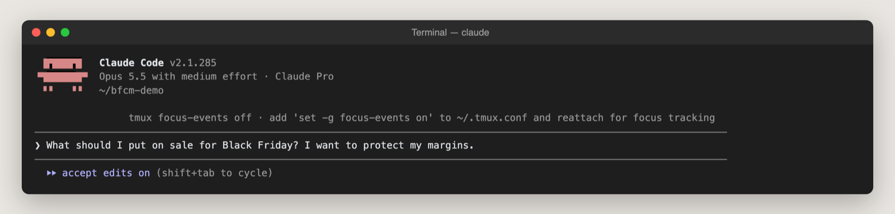</td>
<td width="50%">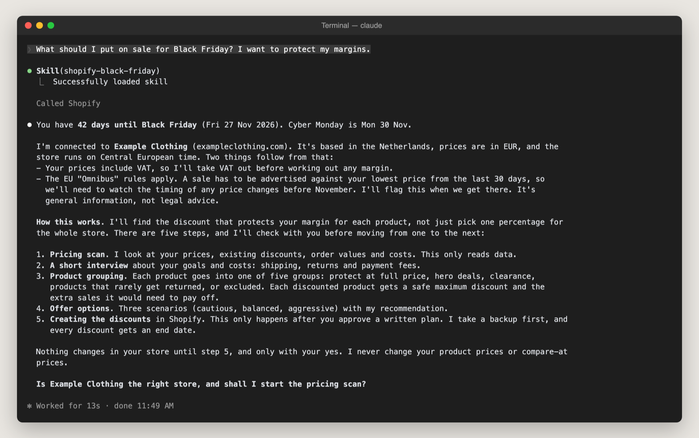</td>
</tr>
</table>

### 2. Pricing scan (read-only)

A pricing snapshot of the store, and what it means. Here the skill also spots that the sets cost
exactly the sum of their tees, and that the stock numbers look like placeholders.

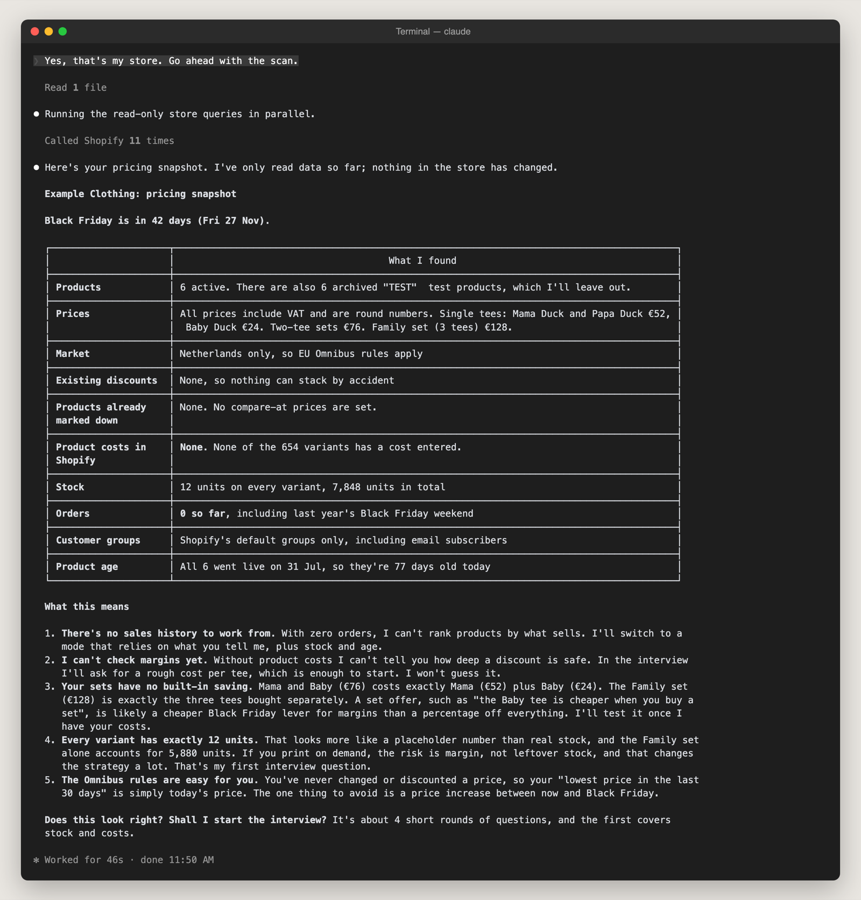

### 3. The interview

Four short rounds. Each question says why it matters, and "I don't know" is a valid answer.

<table>
<tr>
<td width="50%">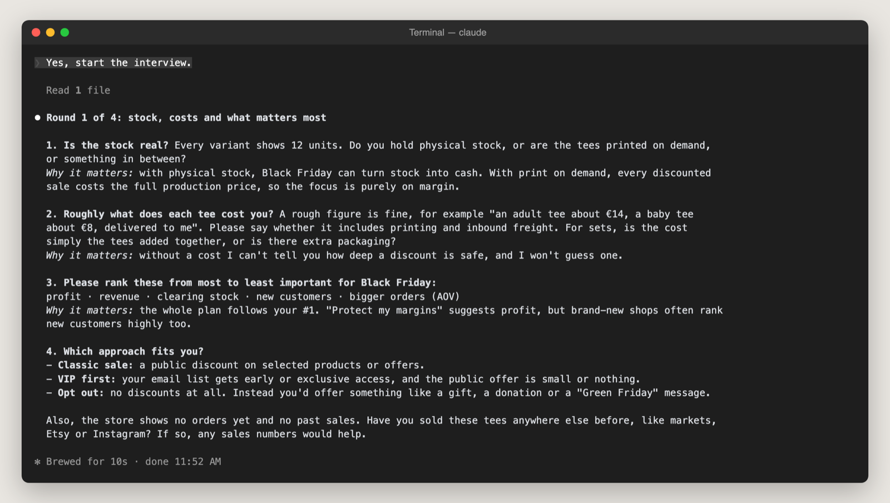</td>
<td width="50%">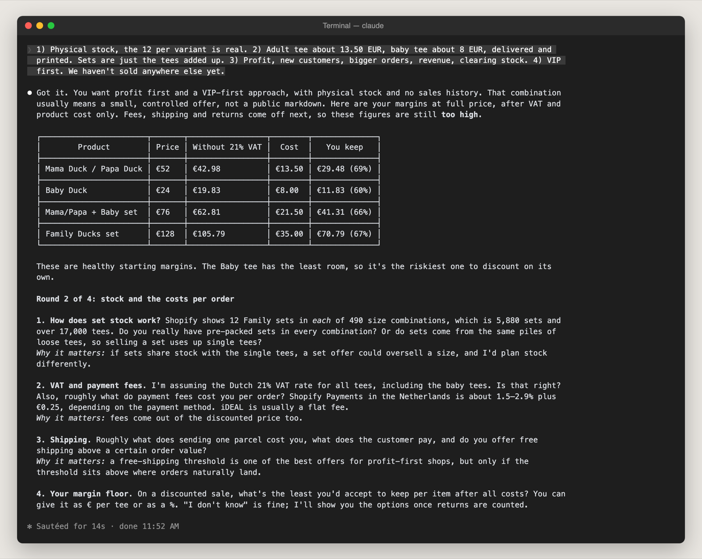</td>
</tr>
<tr>
<td width="50%">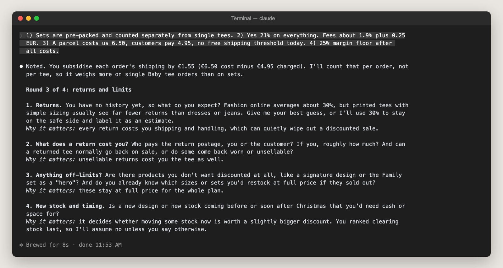</td>
<td width="50%">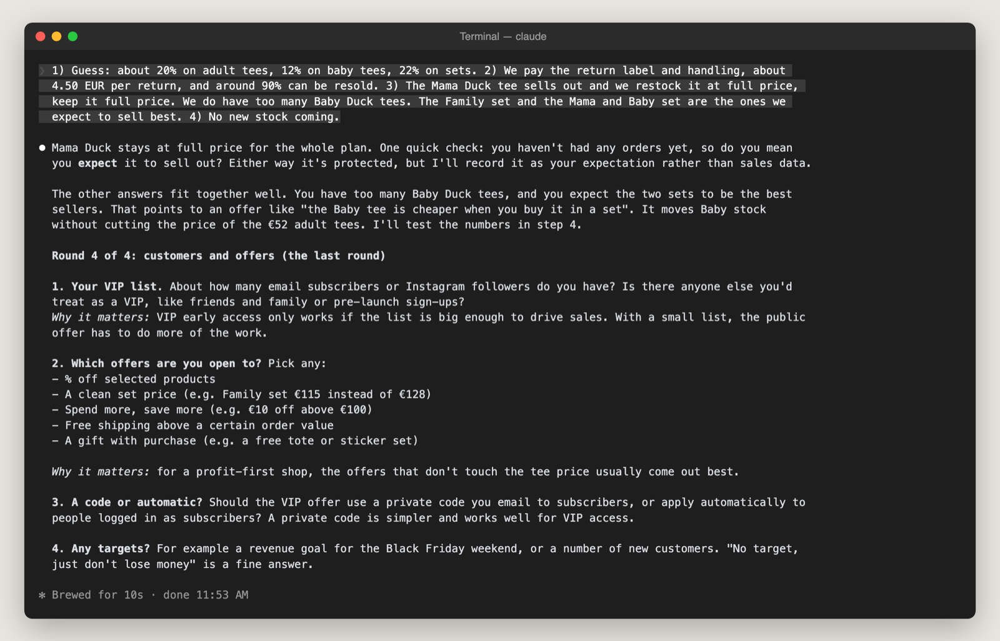</td>
</tr>
</table>

The answers are summarised as a brief you confirm before anything is calculated:

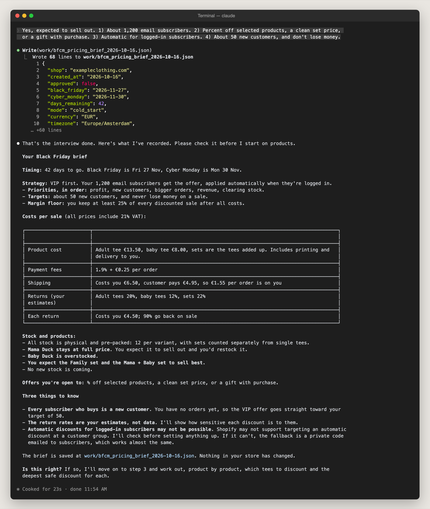

### 4. Products and safe discount depth

Every product gets a role, the money you keep per sale after VAT, fees, shipping and returns, and
the extra volume a discount needs to pay off. When a deep clearance would wipe out the margin on
a low-price item, the skill says so and offers alternatives.

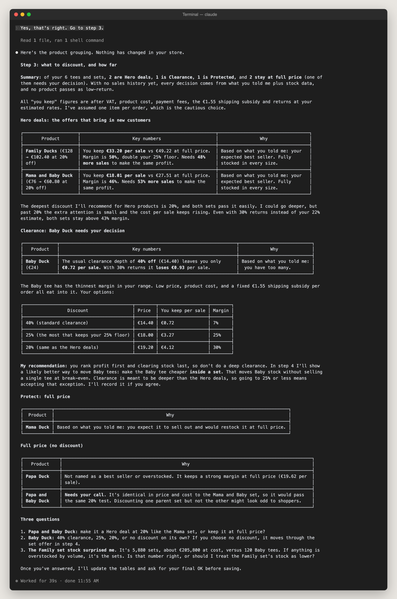

### 5. Offer design and scenarios

Clean set prices, a "€12 add-on" that moves overstocked baby tees without discounting the adult
tees, and three scenarios with one recommendation tied to the merchant's priorities. It also
explains what it *didn't* recommend, and why.

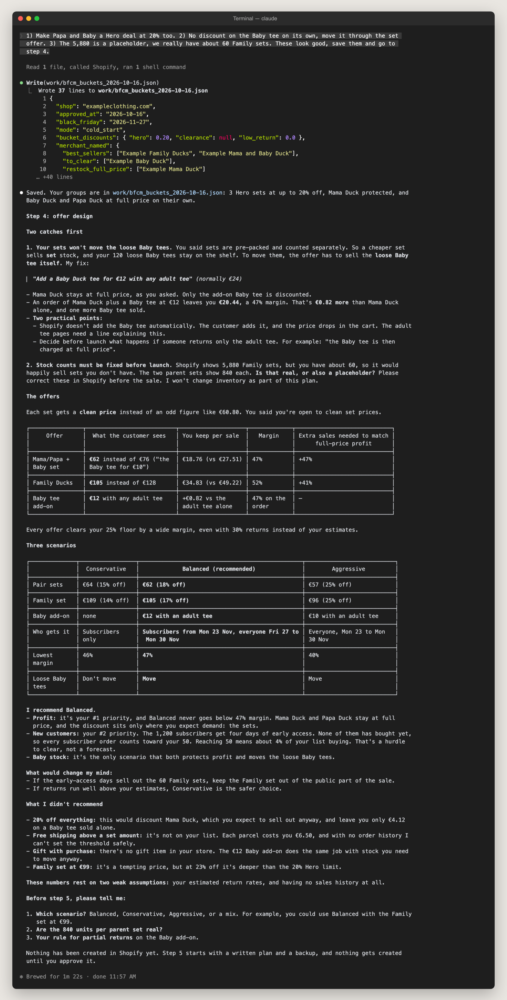

### 6. The plan, and approval before every write

A written plan: every discount, its products, dates and audience, the checks it passed, a
to-do list and the EU notes. Nothing is created until you say yes, and Claude Code asks again
before each change to the store.

<table>
<tr>
<td width="50%">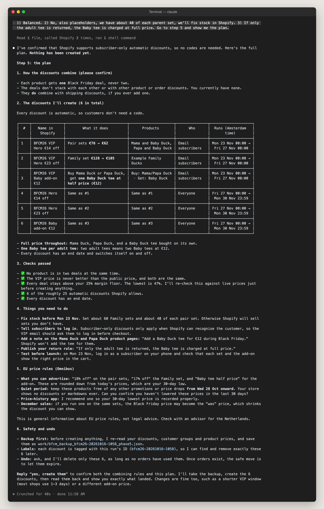</td>
<td width="50%">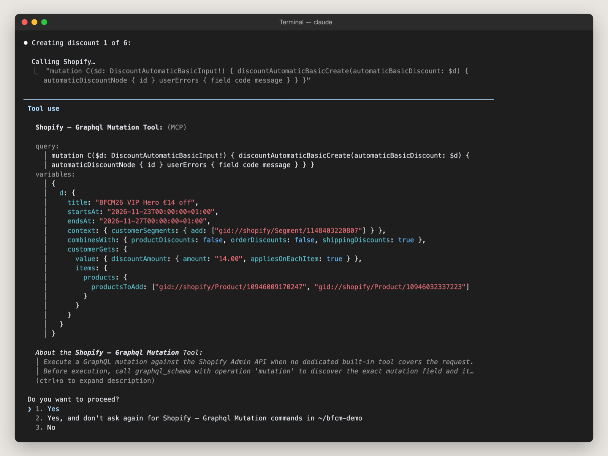</td>
</tr>
</table>

### 7. Done and verified

Every discount is read back from Shopify and confirmed: what customers pay, who gets it, and when.
The answers, product groups and backup are saved as files, and everything can be undone.

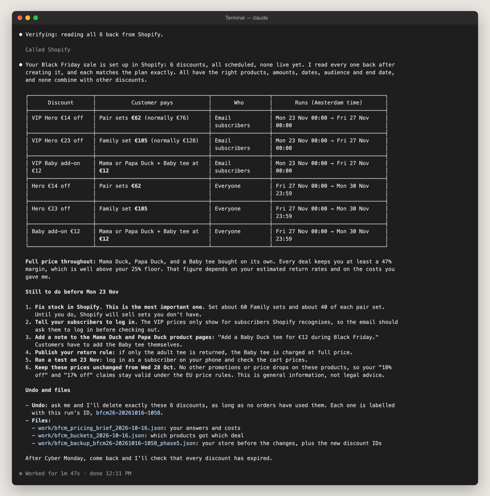

---

## Built-in safeguards

| | |
|---|---|
| **Nothing changes without your yes** | Steps 1–4 only read. Step 5 needs your approval of a written plan. |
| **Backup and one-step undo** | Your store is backed up before any change. Everything the skill creates is marked so it can be removed exactly. |
| **Prices are never edited** | All reductions are discounts with an end date. Product and compare-at prices are never touched. |
| **No numbers invented** | Missing costs or rates are asked for, never guessed. Every assumption is named next to the result. |
| **No deeper deals later** | Later offers are never deeper than earlier ones, so customers don't learn to wait for Cyber Monday. |
| **EU-aware** | Advertised % is computed from your 30-day lowest price, with a "no other promotions after" date. Informational, not legal advice. |

---

## Setup (about 5 minutes)

1. **claude.ai:** Settings → Capabilities → turn on *Code execution and file creation*.
2. **Add the skill:** [download shopify-black-friday.skill](https://github.com/sixfit-ai/shopify-black-friday/releases/latest/download/shopify-black-friday.skill),
   then go to Customize → Skills → upload it.
3. **Connect your store:** Settings → Connectors → Shopify.

*Using Claude Code instead?* Unzip the `.skill` file into `~/.claude/skills/`.

Then just ask:

- *"What should I put on sale for Black Friday?"*
- *"Is 30% off everything a good idea?"*
- *"How deep can my Black Friday discount go without losing money?"*
- *"Black Friday is in 10 days, what discounts should we set up?"*
- *"We're a premium brand. Should we even discount?"*

**Have these numbers ready** (rough is fine): product costs, payment fee %, shipping cost per
parcel, return rate, the cost of a return, and stock you need to clear.

---

## Good to know

- **Pricing only.** No collections, emails, social posts or sale monitoring.
- **No sales forecasts.** It shows the extra volume a discount needs, and compares that with last
  year's real lift when the data exists.
- **New store?** It works without sales history: it asks which products you expect to sell best
  and which need clearing.
- **VIP early access** needs customers to be logged in, so Shopify can recognise them.
- **Shopify limits automatic discounts** to 25 active per store. The plan stays within that.

<details>
<summary><b>For maintainers</b></summary>

<br>

| Path | Contents |
|---|---|
| `SKILL.md` | Workflow and safety rules |
| `references/pricing-interview.md` | Question bank and defaults |
| `references/product-selection.md` | Data pulls, pricing scan, bucket rules, cold-start |
| `references/pricing-math.md` | Margin, maximum safe discount, break-even volume, order offers, scenarios |
| `references/offer-mechanisms.md` | Offer types and how to choose them |
| `references/discounts-and-omnibus.md` | Stacking, schedule checks, EU rules, create / verify / rollback |
| `references/bfcm-fashion-guide.md` | Research knowledge base |

Build the bundle from the parent folder:

```bash
zip -r -X shopify-black-friday/shopify-black-friday.skill \
  shopify-black-friday/SKILL.md shopify-black-friday/references -x '*.DS_Store'
```

</details>

## Support

Open an issue at [github.com/sixfit-ai/shopify-black-friday/issues](https://github.com/sixfit-ai/shopify-black-friday/issues)
or email [hello@sixfit.ai](mailto:hello@sixfit.ai?subject=shopify-black-friday).

## License

MIT — see [LICENSE](LICENSE). Built by [SIXFIT.AI](https://sixfit.ai).
