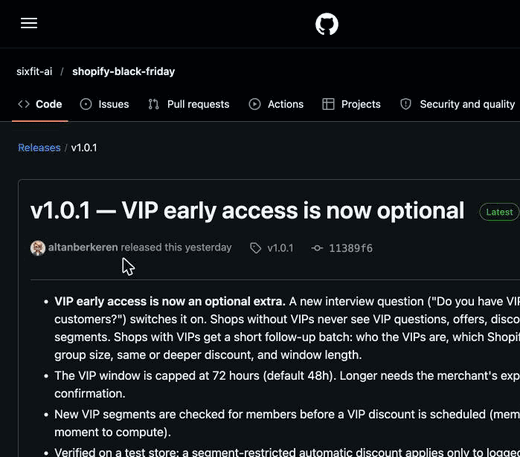
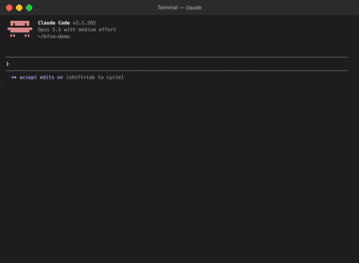
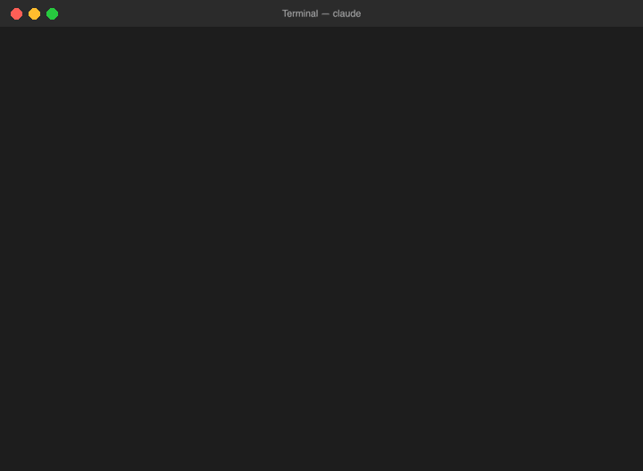

# shopify-black-friday

**A Claude skill that works out your Black Friday pricing from your own numbers: which products
to discount, how deep, and with which offer. Then it sets the discounts up in your Shopify store
once you approve.**

Built for brand leaders and marketing managers of fashion, shoes and accessories brands on
Shopify. No technical knowledge needed: you ask in plain English and answer questions about
your business.

[](https://github.com/sixfit-ai/shopify-black-friday/releases/latest)
[](LICENSE)
[](https://code.claude.com/docs/en/skills)
[](https://shopify.dev/docs/api/admin-graphql)
[](https://sixfit.ai)

---

## Why Black Friday pricing deserves more than a gut feel

Black Friday is where a fashion brand's margin quietly disappears:

- **Returns eat the discount.** Apparel holiday return rates approach **~30%**. A 20% discount
  that looks comfortable on paper can lose money once a third of orders come back.
- **VAT isn't your money.** On VAT-inclusive prices, about **17 points** of every price (at 21%
  VAT) never reaches you. Margins calculated on the shelf price are wrong from the start.
- **Deeper isn't better.** 2025 category discount peaks ran roughly **17–31%**. Going deeper
  than the market buys little extra attention. In 2025, average discounts fell about 10% while
  revenue still grew.
- **The wrong products get discounted.** Bestsellers and new arrivals sell at full price anyway.
  Discounting them gives margin away and teaches customers to wait for the sale.
- **EU rules apply.** Under the Omnibus Directive, any advertised "% off" must be measured
  against your lowest price in the previous 30 days. A promotion in late October can shrink the
  discount you're allowed to show on Black Friday.

*Figures from the research behind this skill ([`references/bfcm-fashion-guide.md`](references/bfcm-fashion-guide.md)).*

This skill replaces gut feel with your own numbers, **product by product**.

---

## What it does

| Step | What happens | Changes your store? |
|---|---|---|
| **1. Pricing scan** | Reads your prices, VAT setting, costs, sales, stock and existing discounts | No |
| **2. Pricing interview** | Asks about your costs, returns, shipping, fees, goals and **priorities**, a few questions at a time | No |
| **3. Products and safe discount depth** | Gives every product a role (Protect, Hero, Clearance, Low-return boost, Exclude) and computes its **maximum safe discount**, the money you keep per sale, and how many extra sales the discount needs to pay off | No |
| **4. Offer design** | Picks the right offer types for your goal (% off, clean price points, add-ons, bundles, free shipping) and presents three scenarios with one recommendation | No |
| **5. Create the discounts** | Shows a written plan, backs up your store, creates the discounts after your **yes**, and reads them back to verify | Yes, after approval |

---

## What you need before you start

**1. A Shopify store you have admin access to.**

**2. Claude, with the Shopify connector switched on and connected to that
store.** Claude reads your store and creates the discounts through it, using
your own Shopify permissions. There is no API key to create and no app to
install in Shopify.

**3. Code execution switched on in Claude.** Open **Settings > Capabilities**
and turn on **Code execution and file creation**. Skills need it.

**4. Your rough numbers.** Product costs, payment fee %, shipping cost per
parcel, return rate, the cost of a return, and stock you need to clear.
Rough is fine, and "I don't know" is a valid answer.

---

## How it works

### 1. Install and verify

**Install**

1. Download `shopify-black-friday.skill` from the
   [Releases page](../../releases/latest): click the file under **Assets**.
   It is a zip file with a different name, so your browser may warn you about
   an unfamiliar file type. That is expected.
2. In Claude, open **Customize > Skills > Add > Upload skill** and upload the file.
3. In Claude's connector settings, turn on the **Shopify** connector and log in
   to your store.

 Skills" width="520">

**Verify**

- The skill is listed under **Customize > Skills** and switched on.
- Ask Claude "Which Shopify store are you connected to?" It should answer with
  your store's name.

### 2. Run the prompt

Ask in plain English. The skill names your store, counts the days to Black
Friday, notices whether your prices include VAT and whether EU price rules
apply, then runs a read-only pricing scan.



Any of these work:

> What should I put on sale for Black Friday? I want to protect my margins.

> Is 30% off everything a good idea?

> Black Friday is in 10 days, what discounts should we set up?

### 3. Answer the questions

Four short rounds: stock and costs, fees and shipping, returns and limits,
customers and offers. Each question says why it matters. Your answers are
summarised as a brief you confirm before anything is calculated.



### 4. Discounts are created

Every product gets a role and a safe maximum discount, then you pick one of
three offer scenarios. You see a written plan, and nothing is created until you
say yes. Every discount is read back from Shopify and checked against the plan.


*Recorded on our test store. The store name is anonymised, the answers are demo
values, and the discounts were deleted afterwards.*

---

## Built-in safeguards

| | |
|---|---|
| **Nothing changes without your yes** | Steps 1–4 only read. Step 5 needs your approval of a written plan. |
| **Backup and one-step undo** | Your store is backed up before any change. Everything the skill creates is marked so it can be removed exactly. |
| **Prices are never edited** | All reductions are discounts with an end date. Product and compare-at prices are never touched. |
| **No numbers invented** | Missing costs or rates are asked for, never guessed. Every assumption is named next to the result. |
| **No deeper deals later** | Later offers are never deeper than earlier ones, so customers don't learn to wait for Cyber Monday. |
| **EU-aware** | Advertised % is computed from your 30-day lowest price, with a "no other promotions after" date. Informational, not legal advice. |

---

## Good to know

- **Pricing only.** No collections, emails, social posts or sale monitoring.
- **No sales forecasts.** It shows the extra volume a discount needs, and compares that with last
  year's real lift when the data exists.
- **New store?** It works without sales history: it asks which products you expect to sell best
  and which need clearing.
- **VIP early access is optional.** The skill asks whether you have VIP customers (loyal repeat
  buyers, a loyalty programme, an email list you'd reward). If not, it leaves VIP out entirely.
  If yes, it sets up a VIP-only discount that opens 1–3 days before Black Friday. Tested: only
  logged-in VIPs get it.
- **Shopify limits automatic discounts** to 25 active per store. The plan stays within that.

## Using Claude Code instead

Unzip the bundle into your skills folder and restart Claude Code:

```
unzip ~/Downloads/shopify-black-friday.skill -d ~/.claude/skills/
```

The answers, product groups and backup are then saved as files in a `work/`
folder, so you can undo from a later session too.

---

<details>
<summary><b>For maintainers</b></summary>

<br>

| Path | Contents |
|---|---|
| `SKILL.md` | Workflow and safety rules |
| `references/pricing-interview.md` | Question bank and defaults |
| `references/product-selection.md` | Data pulls, pricing scan, bucket rules, cold-start |
| `references/pricing-math.md` | Margin, maximum safe discount, break-even volume, order offers, scenarios |
| `references/offer-mechanisms.md` | Offer types and how to choose them |
| `references/discounts-and-omnibus.md` | Stacking, schedule checks, EU rules, create / verify / rollback |
| `references/bfcm-fashion-guide.md` | Research knowledge base |

Build the bundle from the parent folder:

```bash
zip -r -X shopify-black-friday/shopify-black-friday.skill \
  shopify-black-friday/SKILL.md shopify-black-friday/references -x '*.DS_Store'
```

</details>

## Support

Open an issue at [github.com/sixfit-ai/shopify-black-friday/issues](https://github.com/sixfit-ai/shopify-black-friday/issues)
or email [hello@sixfit.ai](mailto:hello@sixfit.ai?subject=shopify-black-friday).

## License

MIT — see [LICENSE](LICENSE). Built by [SIXFIT.AI](https://sixfit.ai).
